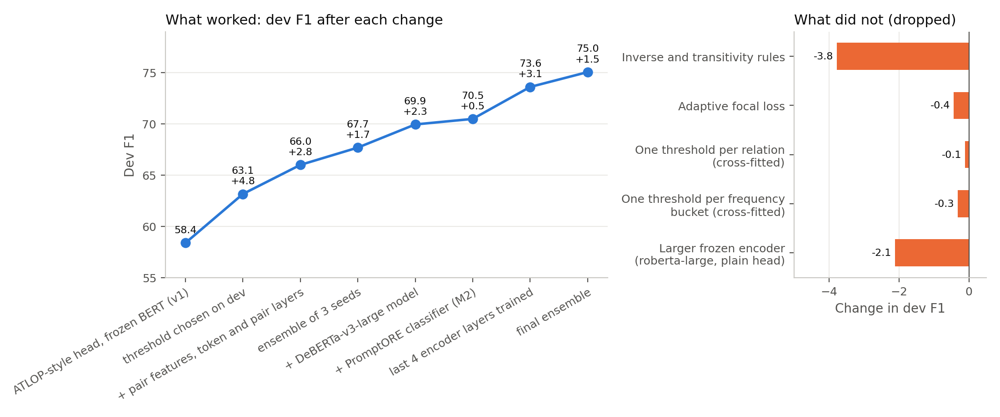
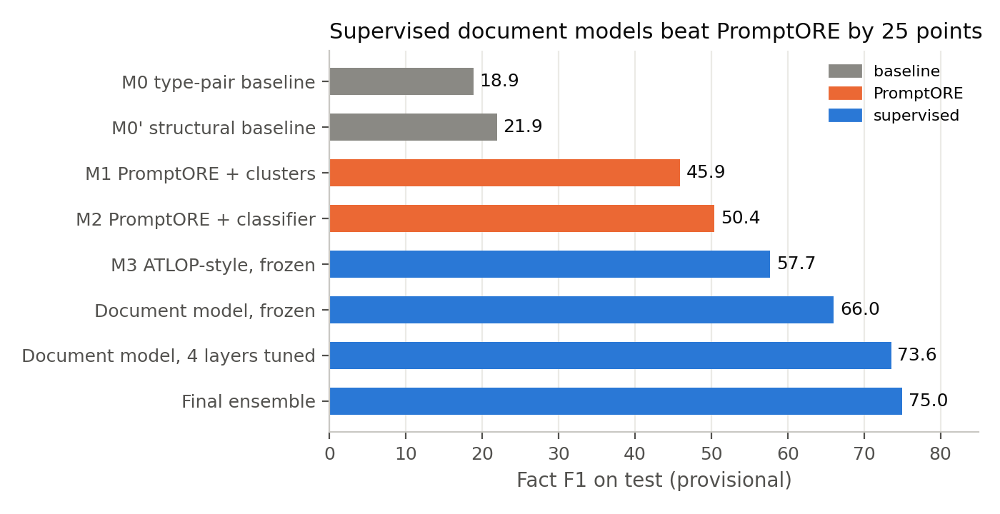
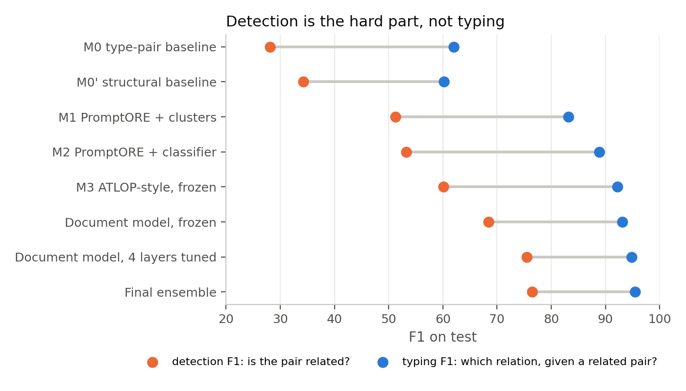

# Presentation material

The story of the project in the order of a talk: the task, the difficulties and how we handled them, what worked and what did not, and the answers to the four research questions. Each part gives its figure (`report/figures/`, written by `scripts/make_figures.py`) and the numbers to quote.

Test scores are **provisional** until the final test run. Analyses use dev only.

## 1. Task and data


- **Task:** given a document whose entities are known (mentions, types, coreference, Wikidata links), find the relations between every ordered pair of entities. Then merge the facts of all documents into one knowledge graph.
- **Data:** Linked-Re-DocRED. It has 3,053 train documents, 500 dev and 500 test, with 96 relations and 85,932 train facts.
- **The two difficulties are in the data itself:**
  - 94.3% of the 1.19 million ordered train pairs have no relation.
  - The relations follow a long tail: two relations have more than 10,000 facts, 30 have fewer than 200.
- **Research questions:**
  1. Can relations discovered without labels (PromptORE) compete with supervised methods?
  2. Do methods fail in **detection** (is the pair related?) or in **typing** (which relation?)?
  3. How many labels does each method need?
  4. How good is the graph, and can its scores be trusted?

## 2. Pipeline

```text
Documents with known entities → candidate ordered pairs → relation method → facts with a score
  → corpus graph (entities merged by Wikidata item, one edge per distinct fact) → shared evaluator
```

| Method | Idea |
|---|---|
| M0 | Baseline: the most frequent relation for each pair of entity types |
| M0' | Structural baseline, still no text: types, sentence distance, mentions and position, with a detector and one classifier per relation as in M2 |
| M1 | PromptORE: a `[MASK]` embedding per pair, k-means clusters, each cluster named after its train facts |
| M2 | PromptORE embeddings with a supervised detector and one classifier per relation |
| M3 | ATLOP-style classifier on the whole document (frozen BERT) |
| Document model | M3 with pair features, token layers and pair-grid layers. Then the last 4 encoder layers trained, then ensembles |

## 3. Difficulties and how we handled them

| Difficulty | What we did | Outcome |
|---|---|---|
| **PromptORE was built for FewRel**, where every instance has exactly one relation. Here 94% of the pairs have none | We first reproduced the paper on FewRel PubMed, then added a "no relation" detector in front of PromptORE | Reproduction within 1.3 points of the paper. On our data, detection becomes the bottleneck (section 5) |
| **Scale:** 1.19 million train pairs, one BERT pass per pair for PromptORE | Kept every related pair and 3 unrelated pairs per related one, with weights so the detector still learns the true share of related pairs. Embeddings cached once | 271,232 train embeddings computed once. Our PromptORE is much faster than the original code |
| **The type filter was supposed to reduce the number of candidates** | Measured it | It removes only 2.7% of the pairs: kept for safety (it loses no related pair), not for speed |
| **No GPU** | Encoder states cached once. Then the last 4 BERT layers are trained from the cached states that enter them, on the laptop GPU (MPS, 2 to 3 minutes per epoch) | +7.5 F1 for one model (66.0 to 73.6), without full fine-tuning |
| **Comparing work done by several people** | Shared evaluator and leaderboard: same files, F1, Ign F1, detection and typing F1, graph metrics, seeds, bootstrap intervals, paired test | Every number on the slides comes from one script |
| **Test was used while methods were still changing** | Rule set on 2026-11-12: dev only until one final test run. Earlier test rows are marked provisional | Dev and test agree within 0.3 point for every document model so far |
| **The learned threshold of M3 was too strict** (precision 73, recall 48) | Fact threshold chosen on dev, checked by cross-fitting on 5 folds of dev | +4.8 F1 on dev, the largest cheap gain. It holds cross-fitted (63.04 against 63.15) |
| **Training diverged** when token layers were combined with other parts | Learning rate lowered from 3e-4 to 1e-4 | Stable |

## 4. What worked and what did not



**What worked**, with the gain on dev F1 of one run, seed 0:

| Change | Gain |
|---|---|
| Fact threshold chosen on dev | +4.8 |
| Pair features, token layers and pair-grid layers together | +2.8 |
| Ensemble of 3 seeds | +1.7 |
| A second frozen encoder, DeBERTa-v3-large | +2.3 |
| PromptORE classifier (M2) in the ensemble: it finds facts the supervised models miss | +0.5 |
| Last 4 encoder layers trained | +3.1, against the frozen ensemble (+7.6 for one model) |
| Final ensemble of the tuned and frozen models | +1.5 |

**What did not work**, all dropped:

| Change | Gain | Why |
|---|---|---|
| Inverse and transitivity rules (P131 implies P17...) | −3.8 | Re-DocRED does not annotate every inferred fact, so the rules add as many false facts as true ones |
| Larger frozen encoder (roberta-large) with the plain head | −2.1 | Without fine-tuning, a larger encoder does not help. DeBERTa only helps with the full head (+1.0) |
| Adaptive focal loss for rare relations | −0.4 | No gain on micro or macro F1 |
| One threshold per relation | −0.1 cross-fitted | It overfits dev: +1.4 on the documents it was tuned on |
| Post-processing of the final ensemble: rules mined from train, one threshold per frequency bucket, a rescorer cross-fitted on dev | +0.05 / −0.3 / +0.3 | Not established: the paired bootstrap interval includes 0. The pair-grid layers already use inverse facts, chains and types; the misses are pairs with low scores everywhere |

**The reasoning behind the order of the steps:** we did the error analysis of v1 before trying any fix. It showed 3 things:

- 89% of the missed facts are pairs never detected.
- M3 was too cautious.
- M3 and M2 make different errors: together they recall 64% of the gold facts, against 49% for M3 alone.

Each fix answers one of these findings: the threshold, then a stronger encoder for detection, then ensembles for the complementary errors.

## 5. Results



| Method | Test F1 | Ign F1 | Graph F1 |
|---|---|---|---|
| M0 type-pair baseline | 18.9 | 17.8 | 19.4 |
| M0' structural baseline | 21.9 ± 0.1 | 20.4 | 22.4 |
| M1 PromptORE + clusters | 45.9 ± 0.4 | 43.6 | 46.0 |
| M2 PromptORE + classifier | 50.4 ± 0.1 | 48.1 | 50.7 |
| M3 ATLOP-style, frozen | 57.7 ± 0.1 | 56.8 | 59.2 |
| Document model, frozen | 66.0 ± 0.1 | 64.5 | 66.9 |
| Document model, 4 layers tuned | 73.6 | 72.3 | 74.3 |
| Final ensemble | **75.0** | **73.8** | **75.8** |

For reference, published ATLOP fully fine-tuned with RoBERTa-large on a GPU has 77.6 F1. Our best model uses BERT-base trained on a laptop and is 2.6 points below.

**Without the text:** M0' uses every structural clue of the dataset (types, distance, mentions, position) and gains only 3 points over M0 on test (+4.3 on dev, significant). Almost all of the F1 of the other methods comes from reading the text.

**Q1, PromptORE against supervised methods:** PromptORE is 25 points below the best model. The gaps are significant: by paired bootstrap on dev, M3 beats M2 by 9.2 points (interval 7.8 to 10.4), and M2 beats M1 by 4.6. PromptORE is still useful in two ways:

- **As a typer:** on the pairs the document model detects, M2 goes from 49.2 to 60.9 dev F1.
- **As an ensemble member:** +0.5.



**Q2, detection against typing:** every method that reads the text types well, with typing F1 from 83 to 95, but detects poorly, with detection F1 from 51 to 77. The hypothesis of the project holds: the hard part is deciding which pairs are related. Most of the progress from M3 to the ensemble comes from detection (60 to 77), while typing moved from 92 to 95. Even M0', which reads no text, has the same gap: detection 34, typing 60.


**Rare relations:** this is still the weakest point, but the gap is shrinking. Macro F1 on rare relations went from 20 (M3) to 47 (ensemble). M1 is the worst (8), because a rare relation rarely dominates a cluster.

Other findings from the error analyses:
- **Distance:** M2 precision drops from 58 to 39 on distant pairs, while M3 sees the whole document and is unaffected.
- **Entity types:** PER-PER and MISC pairs have half the recall of LOC-LOC pairs.
- **Most missed relations:** P131 and P17, which also give a third of the ensemble's false positives.

## 6. Labels needed (Q3)


Dev F1 with a random share of the train documents, 2 draws per share. `scripts/label_efficiency.py` runs M1 and M2, and `train_doc_model.py --train-fraction` runs the frozen document model. Numbers: [label_efficiency.md](label_efficiency.md).

| Train documents | M1 | M2 | Document model, frozen |
|---|---|---|---|
| 5% (153) | 34.2 | 39.9 | 52.1 |
| 25% (763) | 42.2 | 45.9 | 60.7 |
| 100% (3,053) | 44.2 | 49.2 | 66.2 |

- **The document model trained on 153 documents beats PromptORE trained on all 3,053.** It scores 52.1, against 49.2 for M2. The labels are not where PromptORE has its advantage, because they mostly serve detection, and detection is the hard part here.
- **With 5% of the labels, every method keeps about 80% of its F1.**
- **M1 saturates from 50% of the labels:** its clusters do not use them, they only serve to name the clusters.

## 7. The knowledge graph (Q4)


- **Size:** the graph of the ensemble on test has 5,179 nodes and 13,792 edges. Graph F1 is 75.8.
- **Repetition across documents:** an edge stated by one document is right 79% of the time, by 2 documents 98%, by 3 or more 99%. Merging documents is a confidence signal in itself.
- **Demo:** `scripts/visualize_graph.py` shows the gold graph next to the predicted one, by document or around one entity. Correct edges are plain, missed ones dashed and wrong ones in another color, with the evidence sentences.


**Can the scores be trusted?** Precision rises steadily with the score for every model, so scores can rank facts and edges. The values themselves are not probabilities:

- **Final ensemble:** under-confident. Facts scored around 0.27 are right 44% of the time, and facts above 0.9 are right 99% of the time.
- **Tuned model:** over-confident at the top. Facts scored around 0.85 are right 76% of the time.
- **M2:** close to the diagonal.

A calibration step fitted on dev, such as isotonic regression, would fix this without changing the ranking. Numbers: `results/calibration/calibration.json`, written by `scripts/calibration.py`.

## 8. Limits and perspectives

**Limits:**
- One dataset, in English, built from Wikipedia.
- Entities are given: there is no entity detection, coreference resolution or entity linking.
- Most single-model results come from one seed. Differences below about 0.5 point are not established.
- Full fine-tuning was not possible without a GPU.
- Annotation gaps were checked: only 50 of 3,158 false facts of M3 are inverses of gold facts.

**Perspectives:**
- Full fine-tuning of a large encoder on a GPU (ATLOP and DREEAM reach 77 to 78 F1).
- Evidence sentences (DREEAM).
- An LLM used only for typing or for naming clusters.
- Calibrated edge scores.
- Rare relations: class-balanced losses, or soft cluster naming in M1.
